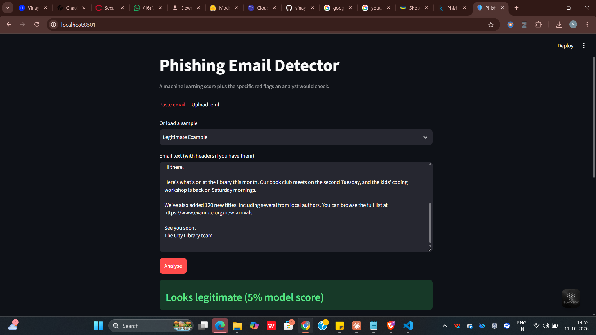
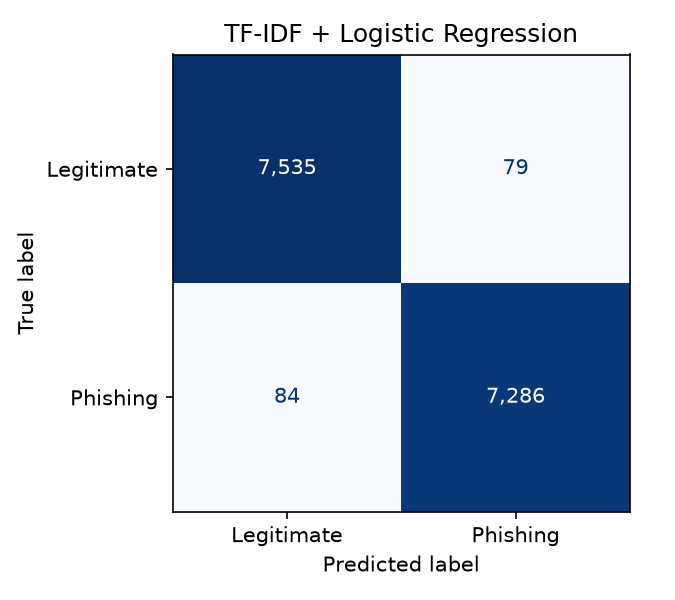

# Phishing Email Detector

Detects phishing emails with machine learning and explains **why** an email looks dangerous, the way a security analyst would.

**[Try the live app](https://YOUR-APP-LINK.streamlit.app)**



## Why I built this

Phishing is still the most common way attackers get into organisations. Most detection demos stop at "the model is 99% accurate". A security analyst needs two more things:

1. **Few false alarms.** Every genuine email flagged as phishing wastes an analyst's time, so I report the false positive rate and the recall at a 1% false positive rate, not just accuracy.
2. **Reasons.** A score on its own can't be acted on. The app shows the specific red flags (failed SPF or DMARC, disguised links, raw IP addresses) and the words that drove the model's score.

## What it does

- **Two models compared:** a fast, explainable baseline (TF-IDF + Logistic Regression) and a fine-tuned transformer (DistilBERT)
- **Rule-based security checks** on the raw email:
  - **Sender:** SPF, DKIM and DMARC results, and Reply-To or Return-Path domains that don't match the sender
  - **Links:** raw IP addresses, URL shorteners, look-alike (punycode) domains, `@` tricks, risky domain endings, login pages without HTTPS, and link text that shows one site but goes to another
  - **Content:** pressure and urgency wording
- **Streamlit app:** paste an email or upload a `.eml` file to get a verdict, the red flags, and the words that raised the score

## Results

Trained and tested on about 75,000 unique emails after removing duplicates.

| Model | Test set | Train rows | Precision | Recall | F1 | False positive rate | Recall @ 1% FPR | ROC-AUC |
|---|---|---|---|---|---|---|---|---|
| TF-IDF + LogReg | Random 80/20 split | 59,934 | 0.989 | 0.989 | 0.989 | 1.04% | 0.988 | 0.999 |
| DistilBERT | Random 80/20 split | 30,000 | 0.993 | 0.985 | 0.989 | 0.71% | 0.992 | 1.000 |
| TF-IDF + LogReg | Unseen source (CEAS 2008) | 41,806 | 0.913 | 0.927 | 0.920 | 8.25% | 0.395 | 0.942 |



### What I found

- **Both models score the same F1 on a random split (0.989).** The baseline trains in seconds on a laptop CPU, while DistilBERT needs a GPU.
- **DistilBERT raises about a third fewer false alarms** (0.71% vs 1.04% of genuine emails), even though it was trained on half as much data. In a security team, that means less analyst time wasted on genuine emails.
- **Performance drops sharply on emails from an unseen source.** When the baseline was tested on the CEAS 2008 dataset, which it never saw during training, F1 fell to 0.920 and false alarms rose about eight-fold to 8.25%. At a 1% false alarm budget it caught only 40% of phishing, compared with 99% on the random split.

Near-perfect scores on random splits mostly show how similar the test emails are to the training emails. New phishing campaigns won't look like old ones, so a real deployment would need regular retraining. That's why the app pairs the model's score with rule-based checks that don't depend on training data.

## How I avoided misleading results

- **Removed duplicates before splitting.** Public phishing datasets contain many copies of the same email. If a copy lands in both the training and test sets, the model is graded on emails it has already seen.
- **Tested on an unseen source.** With `--holdout-source`, the model trains on some datasets and is tested on a completely different one. This is closer to real life.
- **Replaced URLs, email addresses and numbers with tokens,** so the model learns patterns ("asks you to click a link") instead of memorising specific domains.
- **Reported false alarms, not just accuracy.** On a balanced dataset, accuracy hides how often genuine emails get flagged.

## Run it yourself

```bash
git clone https://github.com/YOUR-USERNAME/phishing-detector.git
cd phishing-detector
python -m venv .venv
.venv\Scripts\activate          # Mac/Linux: source .venv/bin/activate
pip install -r requirements.txt

# 1. Get the data (see data/README.md)
# 2. Train and evaluate the baseline
python train_baseline.py
python train_baseline.py --holdout-source CEAS_08
python compare_results.py

# 3. Start the app
streamlit run app.py

# Run the tests
python -m pytest
```

**DistilBERT** needs a GPU. In Google Colab with a T4 GPU, run:

```bash
pip install -q transformers accelerate
python train_distilbert.py --max-train 30000
```

## Project structure

```
app.py                 Streamlit app
train_baseline.py      Train and evaluate TF-IDF + Logistic Regression
train_distilbert.py    Fine-tune DistilBERT on the same split (Colab GPU)
compare_results.py     Build the results table from reports/
src/data.py            Loading, cleaning, de-duplication and splits
src/features.py        Sender, link and content red-flag checks
src/model.py           Baseline model, metrics and explanations
samples/               Fictional example emails for the demo
tests/                 Unit and end-to-end tests
```

## Limitations and next steps

- The public datasets are older and mix phishing with general spam, so modern attacks such as QR-code phishing and AI-written emails are under-represented.
- Attachments aren't analysed.
- **Next:**
  - Test DistilBERT on the unseen CEAS 2008 source to see whether it generalises better than the baseline
  - Add URL reputation lookups (VirusTotal, AbuseIPDB)
  - Evaluate on a set of recent phishing samples

## Data

[Phishing Email Dataset](https://www.kaggle.com/datasets/naserabdullahalam/phishing-email-dataset) on Kaggle, which combines the CEAS 2008, Enron, Ling, Nazario, Nigerian Fraud and SpamAssassin corpora. The sample emails in `samples/` are fictional.

---

Built by **Vinay Appajigowda** · [LinkedIn](https://www.linkedin.com/in/vinay-appajigowda-822aa3206/) · vinayappajigowda@gmail.com